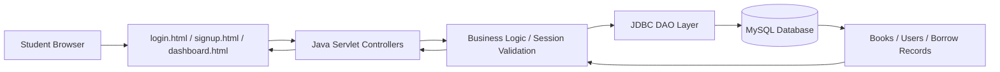
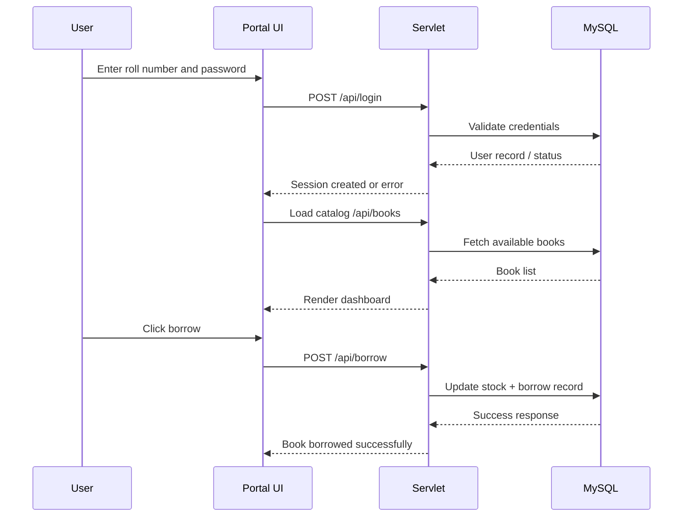
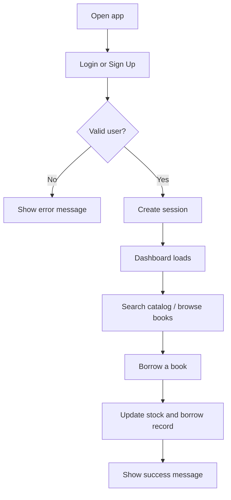

# Student Library Portal

A professional student library management web app that allows students to sign up, log in, browse available books, and borrow titles through a secure portal. The project is designed around a classic MVC-style web architecture using Java Servlets and MySQL, with a clean front-end built using HTML, CSS, and JavaScript.

<p align="center">
  
  
  
  
</p>

## Overview

This portal is built for a college or university library environment where students can:

- Create an account
- Login securely
- Search the library catalog
- View book categories and availability
- Borrow books from the catalog
- Manage a session-based user experience

This is a good foundation for a real-world library system and can be expanded into a production-ready portal with admin dashboards, book returns, fines, and role-based access.

---

## System Architecture



### Core flow



---

## Project Structure

```text
StudentLibraryPortal/
├── login.html
├── signup.html
├── dashboard.html
├── css/
│   └── style.css
├── js/
│   ├── auth.js
│   └── dashboard.js
├── src/
│   └── com/
│       └── library/
│           ├── DBUtil.java
│           ├── PasswordUtil.java
│           ├── SignupServlet.java
│           ├── LoginServlet.java
│           ├── SessionServlet.java
│           ├── BooksServlet.java
│           ├── BorrowServlet.java
│           ├── LogoutServlet.java
│           └── ...
├── WEB-INF/
│   ├── web.xml
│   ├── classes/
│   └── lib/
├── database/
│   └── schema.sql
├── README.md
└── .gitignore
```

---

## Features

- Secure student sign-up and login
- Password hashing with salt (recommended practice)
- Book search and filtering by category/title
- Borrow flow with stock update
- Session-based access control
- Clean dashboard with modern UI styling
- MySQL-backed persistence

---

## Tech Stack

- Frontend: HTML, CSS, JavaScript
- Backend: Java Servlets
- Database: MySQL
- Server: Apache Tomcat
- JDBC: MySQL Connector/J
- Build/Run: JDK + Tomcat + MySQL

---

## What I Observed in This Repository

This project is already structured as a web application with:

- static HTML pages for login/signup/dashboard
- Java Servlet-based backend expected design
- database table logic for users, books, and borrow events
- MVC-style separation of concerns

It is a good academic or learning project because it demonstrates:

- user authentication
- database connectivity with JDBC
- HTTP session usage
- book borrowing logic
- deployment on Tomcat

To make it more dynamic and professional, the following upgrades are recommended:

1. Add a proper service layer for authentication and borrowing operations
2. Add toast notifications and validation messages for UX
3. Display a user profile and borrowed books section
4. Support book return functionality and overdue fines
5. Add admin role and librarian dashboard
6. Add input validation, CSRF protection, and stronger security headers
7. Improve responsive UI and modern dashboard design
8. Add REST-style controller endpoints with clean JSON responses

---

## Prerequisites

To run this project successfully on your system, install the following:

### Required software

- JDK 17 or newer
- Apache Tomcat 9 or 10
- MySQL 8.0+
- MySQL Connector/J JAR file
- A Java IDE (IntelliJ IDEA, Eclipse, or VS Code with Java support)
- Git (optional but recommended)

### Recommended tools

- Postman or Thunder Client for API testing
- MySQL Workbench for DB management
- VS Code for editing HTML/CSS/JS

---

## Installation and Setup

### 1. Install Java

Download and install JDK 17+ from Oracle or Adoptium.

Check version:

```bash
java -version
javac -version
```

### 2. Install Apache Tomcat

Download Tomcat 9 or 10 and unzip it to a folder such as:

- Windows: `C:\apache-tomcat-10`
- Linux/macOS: `/usr/local/tomcat`

Then set `CATALINA_HOME`:

#### Linux/macOS

```bash
export CATALINA_HOME=/path/to/tomcat
```

#### Windows CMD

```cmd
set CATALINA_HOME=C:\apache-tomcat-10
```

### 3. Install MySQL

Install MySQL Community Server 8.0+ and create a database user with access rights.

Example:

```sql
CREATE DATABASE library_portal;
```

### 4. Import the schema

Run the SQL file in your MySQL environment:

```bash
mysql -u root -p < database/schema.sql
```

or import it from MySQL Workbench.

### 5. Configure database credentials

Open your database utility class (for example `DBUtil.java`) and update:

```java
private static final String DB_URL = "jdbc:mysql://localhost:3306/library_portal";
private static final String DB_USER = "root";
private static final String DB_PASSWORD = "your_mysql_password";
```

---

## Build and Run the Project

### 1. Create required folders

Inside your project root:

```bash
mkdir -p WEB-INF/classes WEB-INF/lib
```

### 2. Add MySQL JDBC driver

Download the MySQL Connector/J JAR and place it in:

```text
WEB-INF/lib/
```

### 3. Compile Java sources

```bash
javac -cp "WEB-INF/lib/*:$CATALINA_HOME/lib/servlet-api.jar" -d WEB-INF/classes src/com/library/*.java
```

For Windows:

```cmd
javac -cp "WEB-INF/lib/*;%CATALINA_HOME%\lib\servlet-api.jar" -d WEB-INF/classes src\com\library\*.java
```

### 4. Deploy to Tomcat

Copy your project folder into Tomcat's `webapps` directory:

```bash
cp -r StudentLibraryPortal $CATALINA_HOME/webapps/
```

### 5. Start Tomcat

#### Linux/macOS

```bash
$CATALINA_HOME/bin/startup.sh
```

#### Windows

```cmd
%CATALINA_HOME%\bin\startup.bat
```

### 6. Open the app

Visit:

```text
http://localhost:8080/StudentLibraryPortal/login.html
```

---

## Project Workflow



---

## Recommended Professional Enhancements

Here are the improvements I would suggest to make this project more production-ready:

- Add a real admin dashboard for librarians
- Add book return and overdue tracking
- Add profile management and user history
- Use responsive design for mobile/tablet screens
- Add validation and accessibility improvements
- Add secure password hashing using bcrypt or PBKDF2
- Add role-based access for students vs librarians
- Introduce pagination and filters for large catalogs
- Add logging and error tracking
- Add deployment support with Docker and environment variables

---

## Current Status

This repository is a strong learning project and demonstrates a complete library portal flow using Java Servlets and JDBC. It can be used as a college assignment, mini-project, or starting point for a professional library system.

If you want, the next step could be to transform it into a more modern stack such as:

- Spring Boot + Thymeleaf + MySQL
- Java EE + JSP + MVC + REST API
- Node.js + Express + MongoDB

---

## License

This project is intended for educational and personal use. You can modify and extend it for your own learning and portfolio purposes.

---

## Final Note

This portal already has a strong core idea: a digital library service for students. With a better UI, stronger security, and a more scalable architecture, it can become a polished university library management system.

If you want, I can also help you with any of the following next:

- convert this project to a full professional Java MVC version
- write the complete `DBUtil.java` and SQL schema
- improve the UI with a modern dashboard design
- add admin and borrow return functionality
- create a Spring Boot version of the same project

